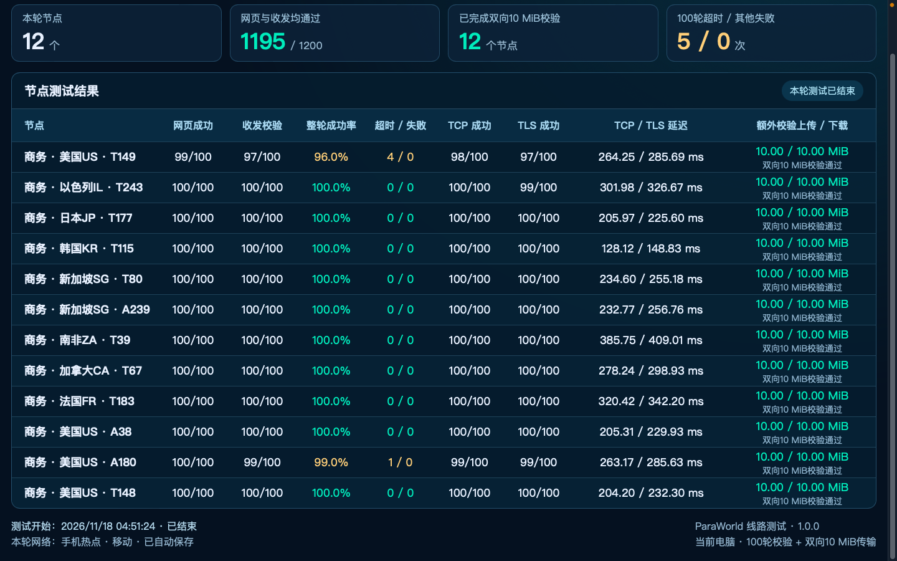
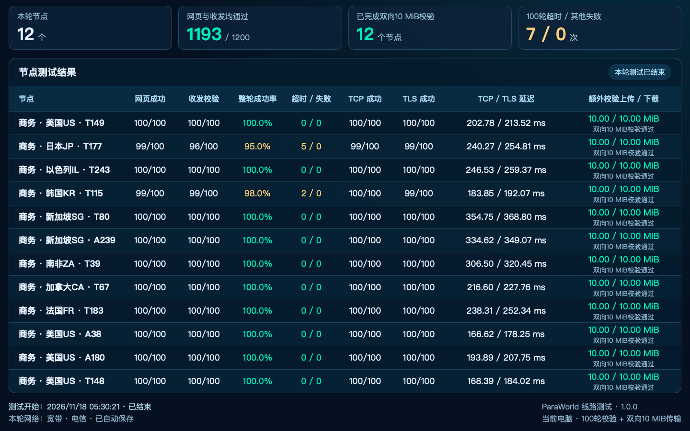

# ParaWorld VPN 平行世界VPN｜第1期｜2026-11-18移动热点／电信宽带节点实测｜机场测评·翻墙梯子·科学上网

**官网：https://paraworldlink.com**

根据两张已完成的测试截图整理。以下时间为北京时间。两种网络分别记录。

本次分别在移动手机热点和电信宽带下测试12个节点。每种网络下，每个节点连续测试100次，并额外完成上传、下载各10MiB的双向校验。

## 1．移动手机热点

测试开始：2026-11-18 04:51:24；状态：已结束。

完整通过：1195/1200（99.58%）；超时：5次；其他失败：0次。12个节点均通过额外上传、下载各10MiB校验。

美国 T149：整轮成功率96.0%，超时4次；美国 A180：整轮成功率99.0%，超时1次。其余10个节点的整轮成功率为100%。

|节点|网页成功|收发校验|整轮成功率|超时／其他失败|TCP成功|TLS成功|TCP延迟(ms)|TLS延迟(ms)|
|---|---|---|---|---|---|---|---|---|
|美国 · T149|99/100|97/100|96.0%|4 / 0|98/100|97/100|264.25|285.69|
|以色列 · T243|100/100|100/100|100.0%|0 / 0|100/100|99/100|301.98|326.67|
|日本 · T177|100/100|100/100|100.0%|0 / 0|100/100|100/100|205.97|225.60|
|韩国 · T115|100/100|100/100|100.0%|0 / 0|100/100|100/100|128.12|148.83|
|新加坡 · T80|100/100|100/100|100.0%|0 / 0|100/100|100/100|234.60|255.18|
|新加坡 · A239|100/100|100/100|100.0%|0 / 0|100/100|100/100|237.77|256.76|
|南非 · T39|100/100|100/100|100.0%|0 / 0|100/100|100/100|385.75|409.01|
|加拿大 · T67|100/100|100/100|100.0%|0 / 0|100/100|100/100|278.24|298.93|
|法国 · T183|100/100|100/100|100.0%|0 / 0|100/100|100/100|320.42|342.20|
|美国 · A38|100/100|100/100|100.0%|0 / 0|100/100|100/100|205.31|229.93|
|美国 · A180|100/100|99/100|99.0%|1 / 0|99/100|99/100|263.17|285.63|
|美国 · T148|100/100|100/100|100.0%|0 / 0|100/100|100/100|204.20|232.30|

## 2．电信宽带

测试开始：2026-11-18 05:30:21；状态：已结束。

完整通过：1193/1200（99.42%）；超时：7次；其他失败：0次。12个节点均通过额外上传、下载各10MiB校验。

日本 T177：整轮成功率95.0%，超时5次；韩国 T115：整轮成功率98.0%，超时2次。其余10个节点的整轮成功率为100%。

|节点|网页成功|收发校验|整轮成功率|超时／其他失败|TCP成功|TLS成功|TCP延迟(ms)|TLS延迟(ms)|
|---|---|---|---|---|---|---|---|---|
|美国 · T149|100/100|100/100|100.0%|0 / 0|100/100|100/100|202.78|213.52|
|日本 · T177|99/100|96/100|95.0%|5 / 0|99/100|99/100|240.27|254.81|
|以色列 · T243|100/100|100/100|100.0%|0 / 0|100/100|100/100|246.53|259.37|
|韩国 · T115|99/100|100/100|98.0%|2 / 0|100/100|99/100|183.85|192.07|
|新加坡 · T80|100/100|100/100|100.0%|0 / 0|100/100|100/100|354.75|368.80|
|新加坡 · A239|100/100|100/100|100.0%|0 / 0|100/100|100/100|334.62|349.07|
|南非 · T39|100/100|100/100|100.0%|0 / 0|100/100|100/100|306.50|320.45|
|加拿大 · T67|100/100|100/100|100.0%|0 / 0|100/100|100/100|216.60|227.76|
|法国 · T183|100/100|100/100|100.0%|0 / 0|100/100|100/100|238.31|252.34|
|美国 · A38|100/100|100/100|100.0%|0 / 0|100/100|100/100|166.62|178.25|
|美国 · A180|100/100|100/100|100.0%|0 / 0|100/100|100/100|193.89|207.75|
|美国 · T148|100/100|100/100|100.0%|0 / 0|100/100|100/100|168.39|184.02|

## 记录口径

完整通过指网页与收发均通过。网页、收发、TCP、TLS分别记录。两轮网络不同，异常节点也不同，因此各轮结果分别解读。

## 标签

#ParaWorldVPN #平行世界VPN #机场测评 #节点测试 #VPN推荐 #翻墙梯子 #科学上网 #Trojan #AnyTLS #移动热点 #电信宽带
