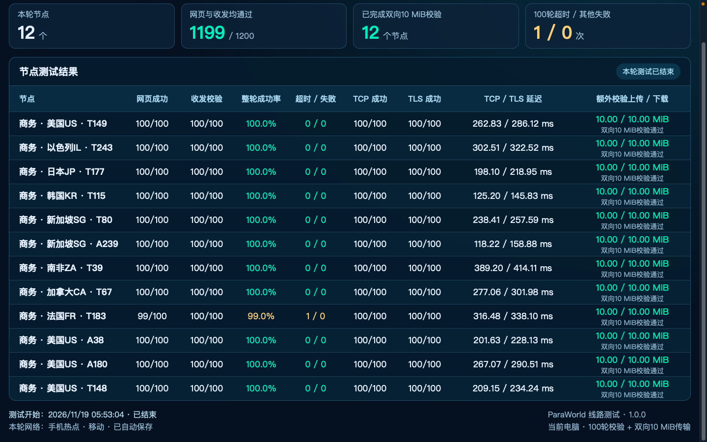
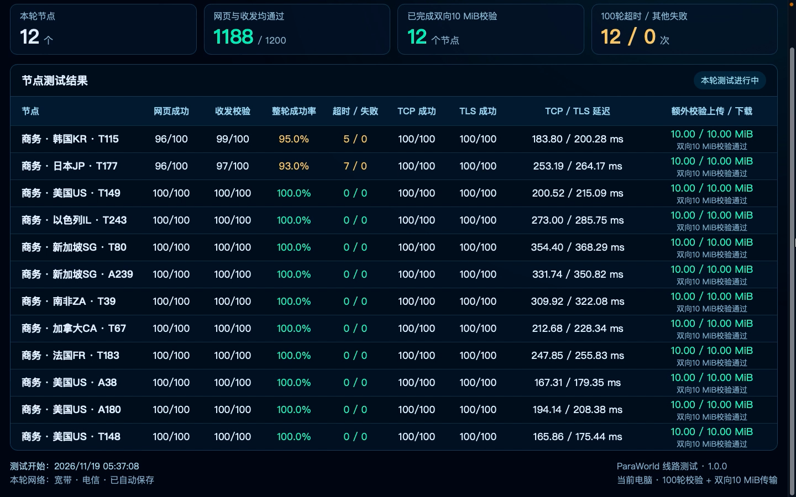

**官网：[https://paraworldlink.com](https://paraworldlink.com)**  
**电报：[https://t.me/paraworldvpn](https://t.me/paraworldvpn)**  
**YouTube：[阿飞笔记（官方客服阿飞）](https://www.youtube.com/@afeibiji)**  
**X：[https://x.com/ParaworldVPN](https://x.com/ParaworldVPN)**

# ParaWorld VPN 平行世界VPN｜第2期｜2026-11-19移动热点／电信宽带节点实测｜机场测评·翻墙梯子·科学上网

根据今天早间的两张测试截图整理。以下时间为北京时间。两种网络分别记录。

本次分别在移动手机热点和电信宽带下测试12个节点。每种网络下，每个节点连续测试100次，另进行上传、下载各10MiB的双向校验。

## 1．移动手机热点（移动）

测试开始：2026-11-19 05:53:04；状态：已结束。

完整通过：1199/1200（99.92%）；超时：1次；其他失败：0次。12个节点均完成上传10.00MiB、下载10.00MiB，双向校验通过。

11个节点的100次测试全部通过。法国 T183 网页成功99次、收发校验100次，整轮成功99次，出现1次超时。

|节点|网页成功|收发校验|整轮成功率|超时／其他失败|TCP成功|TLS成功|TCP延迟(ms)|TLS延迟(ms)|
|---|---|---|---|---|---|---|---|---|
|美国 · T149|100/100|100/100|100.0%|0 / 0|100/100|100/100|262.83|286.12|
|以色列 · T243|100/100|100/100|100.0%|0 / 0|100/100|100/100|302.51|322.52|
|日本 · T177|100/100|100/100|100.0%|0 / 0|100/100|100/100|198.10|218.95|
|韩国 · T115|100/100|100/100|100.0%|0 / 0|100/100|100/100|125.20|145.83|
|新加坡 · T80|100/100|100/100|100.0%|0 / 0|100/100|100/100|238.41|257.59|
|新加坡 · A239|100/100|100/100|100.0%|0 / 0|100/100|100/100|118.22|158.88|
|南非 · T39|100/100|100/100|100.0%|0 / 0|100/100|100/100|389.20|414.11|
|加拿大 · T67|100/100|100/100|100.0%|0 / 0|100/100|100/100|277.06|301.98|
|法国 · T183|99/100|100/100|99.0%|1 / 0|100/100|100/100|316.48|338.10|
|美国 · A38|100/100|100/100|100.0%|0 / 0|100/100|100/100|201.63|228.13|
|美国 · A180|100/100|100/100|100.0%|0 / 0|100/100|100/100|267.07|290.51|
|美国 · T148|100/100|100/100|100.0%|0 / 0|100/100|100/100|209.15|234.24|

## 2．电信宽带

测试开始：2026-11-19 05:37:08；状态：100次测试及双向校验均已完成（截图状态栏仍显示“测试进行中”）。

完整通过：1188/1200（99.00%）；超时：12次；其他失败：0次。12个节点均完成上传10.00MiB、下载10.00MiB，双向校验通过。

10个节点的100次测试全部通过。韩国 T115 整轮成功95次，超时5次；日本 T177 整轮成功93次，超时7次。12个节点均已通过额外上传、下载各10MiB的双向校验。

|节点|网页成功|收发校验|整轮成功率|超时／其他失败|TCP成功|TLS成功|TCP延迟(ms)|TLS延迟(ms)|
|---|---|---|---|---|---|---|---|---|
|韩国 · T115|96/100|99/100|95.0%|5 / 0|100/100|100/100|183.80|200.28|
|日本 · T177|96/100|97/100|93.0%|7 / 0|100/100|100/100|253.19|264.17|
|美国 · T149|100/100|100/100|100.0%|0 / 0|100/100|100/100|200.52|215.09|
|以色列 · T243|100/100|100/100|100.0%|0 / 0|100/100|100/100|273.00|285.75|
|新加坡 · T80|100/100|100/100|100.0%|0 / 0|100/100|100/100|354.40|368.29|
|新加坡 · A239|100/100|100/100|100.0%|0 / 0|100/100|100/100|331.74|350.82|
|南非 · T39|100/100|100/100|100.0%|0 / 0|100/100|100/100|309.92|322.08|
|加拿大 · T67|100/100|100/100|100.0%|0 / 0|100/100|100/100|212.68|228.34|
|法国 · T183|100/100|100/100|100.0%|0 / 0|100/100|100/100|247.85|255.83|
|美国 · A38|100/100|100/100|100.0%|0 / 0|100/100|100/100|167.31|179.35|
|美国 · A180|100/100|100/100|100.0%|0 / 0|100/100|100/100|194.14|208.38|
|美国 · T148|100/100|100/100|100.0%|0 / 0|100/100|100/100|165.86|175.44|

## 记录口径

完整通过指网页与收发均通过。网页、收发、TCP、TLS分别记录。两轮网络不同，异常节点也不同，因此各轮结果分别解读。

## 标签

#ParaWorldVPN #平行世界VPN #机场测评 #节点测试 #VPN推荐 #翻墙梯子 #科学上网 #Trojan #AnyTLS #移动热点 #电信宽带
