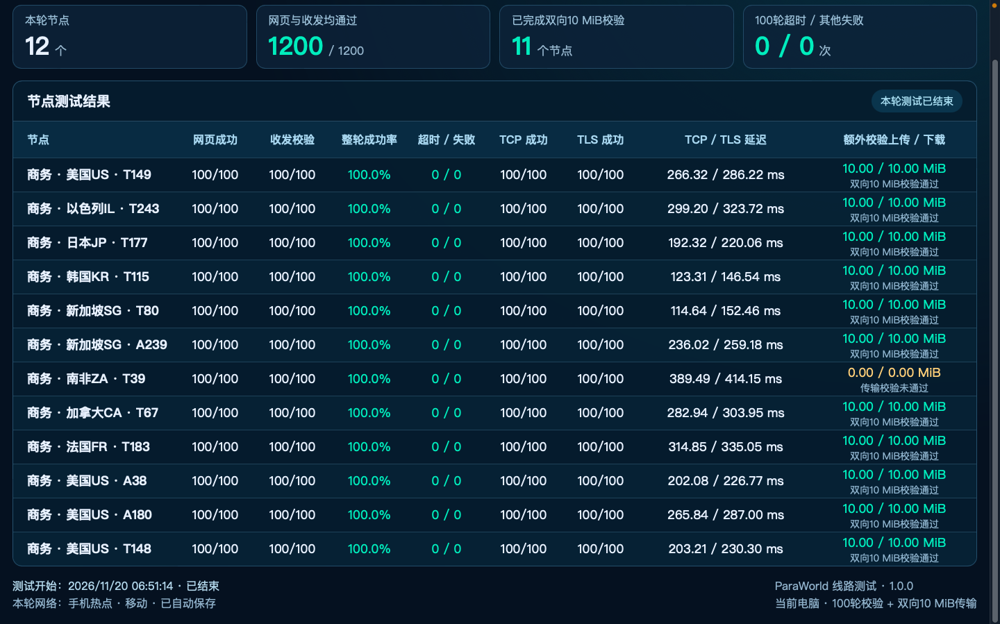
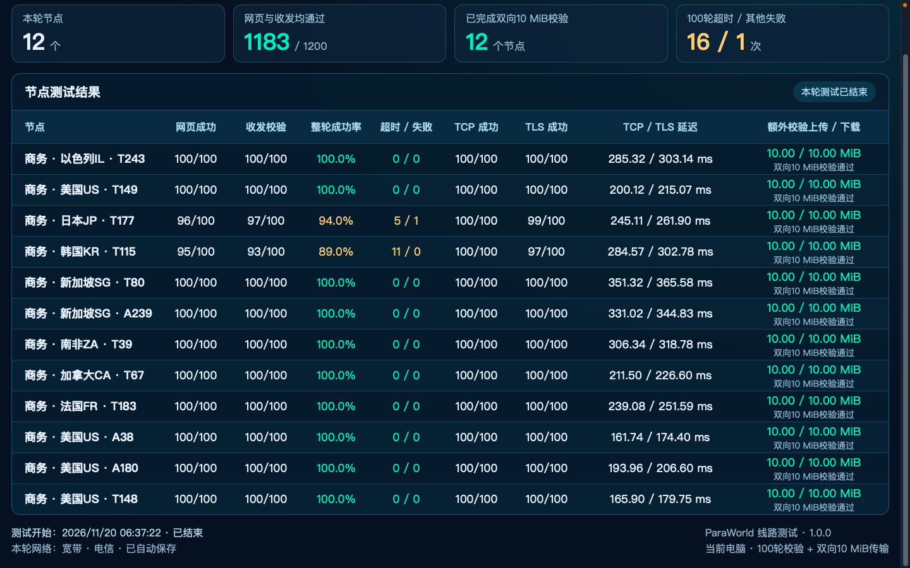

**官网：[https://paraworldlink.com](https://paraworldlink.com)**  
**电报：[https://t.me/paraworldvpn](https://t.me/paraworldvpn)**  
**YouTube：[阿飞笔记（官方客服阿飞）](https://www.youtube.com/@afeibiji)**  
**X：[https://x.com/ParaworldVPN](https://x.com/ParaworldVPN)**

# ParaWorld VPN 平行世界VPN｜第3期｜2026-11-20移动热点／电信宽带节点实测｜机场测评·翻墙梯子·科学上网

根据今天早间的两张测试截图整理。以下时间为北京时间。两种网络分别记录。

本次分别在移动手机热点和电信宽带下测试12个节点。每种网络下，每个节点连续测试100次，另进行上传、下载各10MiB的双向校验。

## 1．移动手机热点（移动）

测试开始：2026-11-20 06:51:14；状态：已结束。

完整通过：1200/1200（100.00%）；超时：0次；其他失败：0次。11个节点完成上传、下载各10.00MiB并通过校验。南非 T39 的额外传输校验未通过，截图显示上传、下载均为0.00MiB。

12个节点的网页访问与小数据收发测试均为100/100，没有超时或其他失败。额外传输校验中，南非 T39 显示0.00 / 0.00MiB、校验未通过；其余11个节点通过。

|节点|网页成功|收发校验|整轮成功率|超时／其他失败|TCP成功|TLS成功|TCP延迟(ms)|TLS延迟(ms)|额外校验：上传／下载|
|---|---|---|---|---|---|---|---|---|---|
|美国 · T149|100/100|100/100|100.0%|0 / 0|100/100|100/100|266.32|286.22|10.00 / 10.00 MiB（通过）|
|以色列 · T243|100/100|100/100|100.0%|0 / 0|100/100|100/100|299.20|323.72|10.00 / 10.00 MiB（通过）|
|日本 · T177|100/100|100/100|100.0%|0 / 0|100/100|100/100|192.32|220.06|10.00 / 10.00 MiB（通过）|
|韩国 · T115|100/100|100/100|100.0%|0 / 0|100/100|100/100|123.31|146.54|10.00 / 10.00 MiB（通过）|
|新加坡 · T80|100/100|100/100|100.0%|0 / 0|100/100|100/100|114.64|152.46|10.00 / 10.00 MiB（通过）|
|新加坡 · A239|100/100|100/100|100.0%|0 / 0|100/100|100/100|236.02|259.18|10.00 / 10.00 MiB（通过）|
|南非 · T39|100/100|100/100|100.0%|0 / 0|100/100|100/100|389.49|414.15|0.00 / 0.00 MiB（未通过）|
|加拿大 · T67|100/100|100/100|100.0%|0 / 0|100/100|100/100|282.94|303.95|10.00 / 10.00 MiB（通过）|
|法国 · T183|100/100|100/100|100.0%|0 / 0|100/100|100/100|314.85|335.05|10.00 / 10.00 MiB（通过）|
|美国 · A38|100/100|100/100|100.0%|0 / 0|100/100|100/100|202.08|226.77|10.00 / 10.00 MiB（通过）|
|美国 · A180|100/100|100/100|100.0%|0 / 0|100/100|100/100|265.84|287.00|10.00 / 10.00 MiB（通过）|
|美国 · T148|100/100|100/100|100.0%|0 / 0|100/100|100/100|203.21|230.30|10.00 / 10.00 MiB（通过）|

## 2．电信宽带

测试开始：2026-11-20 06:37:22；状态：已结束。

完整通过：1183/1200（98.58%）；超时：16次；其他失败：1次。12个节点均完成上传10.00MiB、下载10.00MiB，双向校验通过。

10个节点的100次测试全部通过。日本 T177 整轮成功94次，超时5次、其他失败1次；韩国 T115 整轮成功89次，超时11次。额外双向传输校验12个节点全部通过。

|节点|网页成功|收发校验|整轮成功率|超时／其他失败|TCP成功|TLS成功|TCP延迟(ms)|TLS延迟(ms)|额外校验：上传／下载|
|---|---|---|---|---|---|---|---|---|---|
|以色列 · T243|100/100|100/100|100.0%|0 / 0|100/100|100/100|285.32|303.14|10.00 / 10.00 MiB（通过）|
|美国 · T149|100/100|100/100|100.0%|0 / 0|100/100|100/100|200.12|215.07|10.00 / 10.00 MiB（通过）|
|日本 · T177|96/100|97/100|94.0%|5 / 1|100/100|99/100|245.11|261.90|10.00 / 10.00 MiB（通过）|
|韩国 · T115|95/100|93/100|89.0%|11 / 0|100/100|97/100|284.57|302.78|10.00 / 10.00 MiB（通过）|
|新加坡 · T80|100/100|100/100|100.0%|0 / 0|100/100|100/100|351.32|365.58|10.00 / 10.00 MiB（通过）|
|新加坡 · A239|100/100|100/100|100.0%|0 / 0|100/100|100/100|331.02|344.83|10.00 / 10.00 MiB（通过）|
|南非 · T39|100/100|100/100|100.0%|0 / 0|100/100|100/100|306.34|318.78|10.00 / 10.00 MiB（通过）|
|加拿大 · T67|100/100|100/100|100.0%|0 / 0|100/100|100/100|211.50|226.60|10.00 / 10.00 MiB（通过）|
|法国 · T183|100/100|100/100|100.0%|0 / 0|100/100|100/100|239.08|251.59|10.00 / 10.00 MiB（通过）|
|美国 · A38|100/100|100/100|100.0%|0 / 0|100/100|100/100|161.74|174.40|10.00 / 10.00 MiB（通过）|
|美国 · A180|100/100|100/100|100.0%|0 / 0|100/100|100/100|193.96|206.60|10.00 / 10.00 MiB（通过）|
|美国 · T148|100/100|100/100|100.0%|0 / 0|100/100|100/100|165.90|179.75|10.00 / 10.00 MiB（通过）|

## 记录口径

完整通过指网页与收发均通过。网页、收发、TCP、TLS分别记录。两轮网络不同，异常节点也不同，因此各轮结果分别解读。

额外10MiB传输校验单独记录，不计入1200次测试的通过数和失败数。

## 标签

#ParaWorldVPN #平行世界VPN #机场测评 #节点测试 #VPN推荐 #翻墙梯子 #科学上网 #Trojan #AnyTLS #移动热点 #电信宽带
