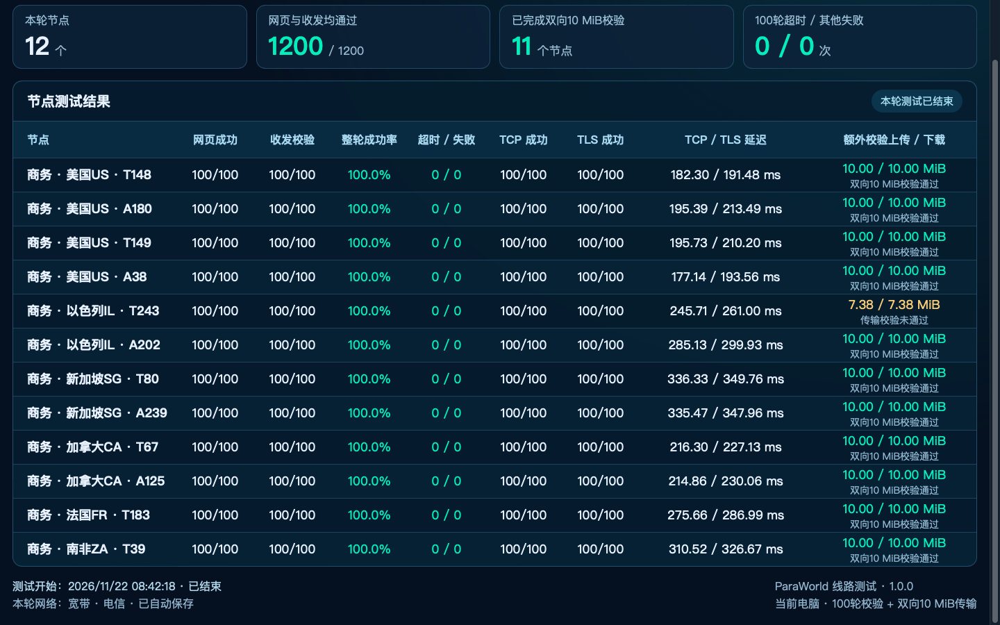
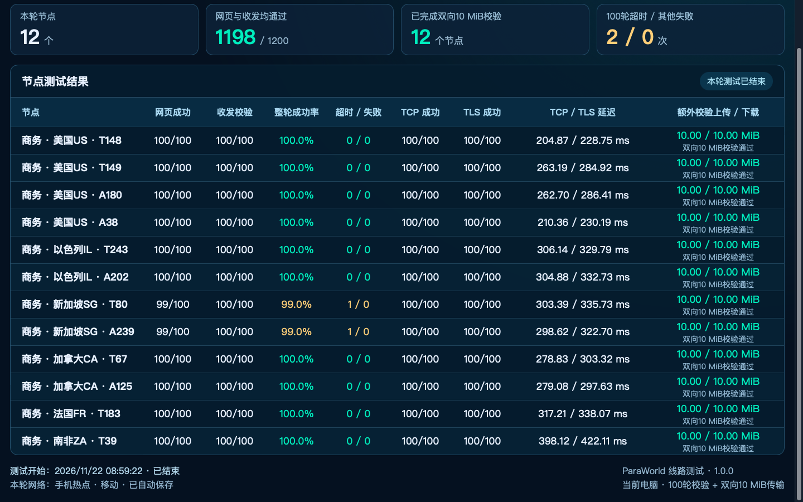

**官网：[https://paraworldlink.com](https://paraworldlink.com)**

# 第4期｜2026年11月22日早间节点测试日志

本次使用替换后的节点列表测试：原日本 **T177（Trojan）**、韩国 **T115（Trojan）** 已下线注销，新增 **加拿大 A125（AnyTLS）** 和 **以色列 A202（AnyTLS）**。加拿大 T67、以色列 T243 两条原有 Trojan 节点继续保留。

| 调整 | 地区 | 节点 | 协议 |
|---|---|---|---|
| 下线注销 | 日本 | T177 | Trojan |
| 下线注销 | 韩国 | T115 | Trojan |
| 新增上线 | 加拿大 | A125 | AnyTLS |
| 新增上线 | 以色列 | A202 | AnyTLS |

[查看节点调整详细报告](https://github.com/lkkq996/paraworld-vpn/issues/5)

本次分别使用电信宽带和移动手机热点测试12个节点。每种网络下，每个节点连续测试100次，另进行上传、下载各10MiB的双向校验。以下时间均为北京时间。

两种网络下，新增加拿大 A125、以色列 A202 的100次测试均全部通过，额外双向10MiB传输校验也均通过。

## 1．电信宽带

测试开始：2026-11-22 08:42:18；状态：已结束。

完整通过：1200/1200（100.00%）；超时：0次；其他失败：0次。额外双向10MiB校验通过：11/12个节点。

12个节点的网页与小数据收发测试均为100/100，无超时或其他失败。额外传输校验有11个节点通过；以色列 T243 显示上传7.38MiB、下载7.38MiB，传输校验未通过。

|节点|网页成功|收发校验|整轮成功率|超时／其他失败|TCP成功|TLS成功|TCP延迟(ms)|TLS延迟(ms)|额外校验：上传／下载|
|---|---|---|---|---|---|---|---|---|---|
|美国 · T148|100/100|100/100|100.0%|0 / 0|100/100|100/100|182.30|191.48|10.00 / 10.00 MiB（通过）|
|美国 · A180|100/100|100/100|100.0%|0 / 0|100/100|100/100|195.39|213.49|10.00 / 10.00 MiB（通过）|
|美国 · T149|100/100|100/100|100.0%|0 / 0|100/100|100/100|195.73|210.20|10.00 / 10.00 MiB（通过）|
|美国 · A38|100/100|100/100|100.0%|0 / 0|100/100|100/100|177.14|193.56|10.00 / 10.00 MiB（通过）|
|以色列 · T243|100/100|100/100|100.0%|0 / 0|100/100|100/100|245.71|261.00|7.38 / 7.38 MiB（未通过）|
|以色列 · A202|100/100|100/100|100.0%|0 / 0|100/100|100/100|285.13|299.93|10.00 / 10.00 MiB（通过）|
|新加坡 · T80|100/100|100/100|100.0%|0 / 0|100/100|100/100|336.33|349.76|10.00 / 10.00 MiB（通过）|
|新加坡 · A239|100/100|100/100|100.0%|0 / 0|100/100|100/100|335.47|347.96|10.00 / 10.00 MiB（通过）|
|加拿大 · T67|100/100|100/100|100.0%|0 / 0|100/100|100/100|216.30|227.13|10.00 / 10.00 MiB（通过）|
|加拿大 · A125|100/100|100/100|100.0%|0 / 0|100/100|100/100|214.86|230.06|10.00 / 10.00 MiB（通过）|
|法国 · T183|100/100|100/100|100.0%|0 / 0|100/100|100/100|275.66|286.99|10.00 / 10.00 MiB（通过）|
|南非 · T39|100/100|100/100|100.0%|0 / 0|100/100|100/100|310.52|326.67|10.00 / 10.00 MiB（通过）|

## 2．移动手机热点（移动）

测试开始：2026-11-22 08:59:22；状态：已结束。

完整通过：1198/1200（99.83%）；超时：2次；其他失败：0次。额外双向10MiB校验通过：12/12个节点。

新加坡 T80、A239 各出现1次网页访问超时，网页成功99/100，收发校验100/100，整轮成功率99.0%；其余10个节点的100次测试全部通过。12个节点均通过额外上传、下载各10MiB校验。

|节点|网页成功|收发校验|整轮成功率|超时／其他失败|TCP成功|TLS成功|TCP延迟(ms)|TLS延迟(ms)|额外校验：上传／下载|
|---|---|---|---|---|---|---|---|---|---|
|美国 · T148|100/100|100/100|100.0%|0 / 0|100/100|100/100|204.87|228.75|10.00 / 10.00 MiB（通过）|
|美国 · T149|100/100|100/100|100.0%|0 / 0|100/100|100/100|263.19|284.92|10.00 / 10.00 MiB（通过）|
|美国 · A180|100/100|100/100|100.0%|0 / 0|100/100|100/100|262.70|286.41|10.00 / 10.00 MiB（通过）|
|美国 · A38|100/100|100/100|100.0%|0 / 0|100/100|100/100|210.36|230.19|10.00 / 10.00 MiB（通过）|
|以色列 · T243|100/100|100/100|100.0%|0 / 0|100/100|100/100|306.14|329.79|10.00 / 10.00 MiB（通过）|
|以色列 · A202|100/100|100/100|100.0%|0 / 0|100/100|100/100|304.88|332.73|10.00 / 10.00 MiB（通过）|
|新加坡 · T80|99/100|100/100|99.0%|1 / 0|100/100|100/100|303.39|335.73|10.00 / 10.00 MiB（通过）|
|新加坡 · A239|99/100|100/100|99.0%|1 / 0|100/100|100/100|298.62|322.70|10.00 / 10.00 MiB（通过）|
|加拿大 · T67|100/100|100/100|100.0%|0 / 0|100/100|100/100|278.83|303.32|10.00 / 10.00 MiB（通过）|
|加拿大 · A125|100/100|100/100|100.0%|0 / 0|100/100|100/100|279.08|297.63|10.00 / 10.00 MiB（通过）|
|法国 · T183|100/100|100/100|100.0%|0 / 0|100/100|100/100|317.21|338.07|10.00 / 10.00 MiB（通过）|
|南非 · T39|100/100|100/100|100.0%|0 / 0|100/100|100/100|398.12|422.11|10.00 / 10.00 MiB（通过）|

## 记录口径

完整通过指同一次测试中的网页访问与小数据收发均通过。额外10MiB传输校验单独记录，不计入1200次测试的通过数和失败数。因此，电信宽带1200/1200次通过与以色列 T243 额外传输校验未通过，是两项不同的结果。

## 标签

#ParaWorldVPN #平行世界VPN #机场测评 #节点测试 #VPN推荐 #翻墙 #梯子 #科学上网 #Trojan #AnyTLS #电信宽带 #移动热点
