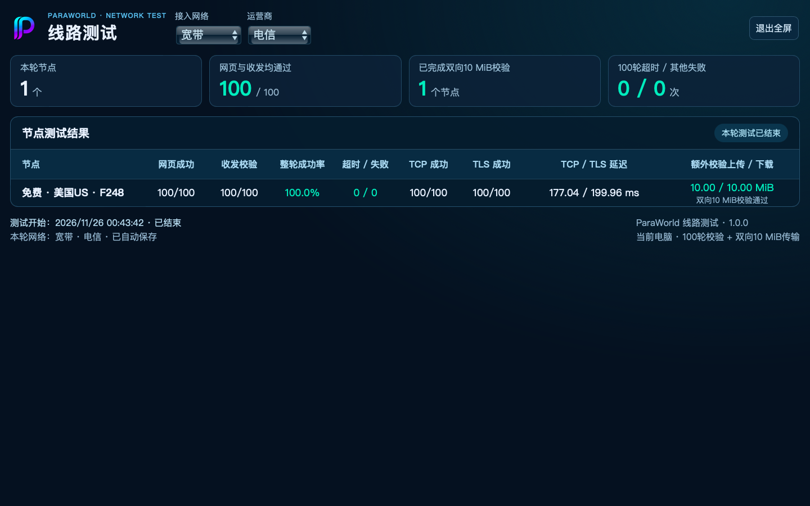
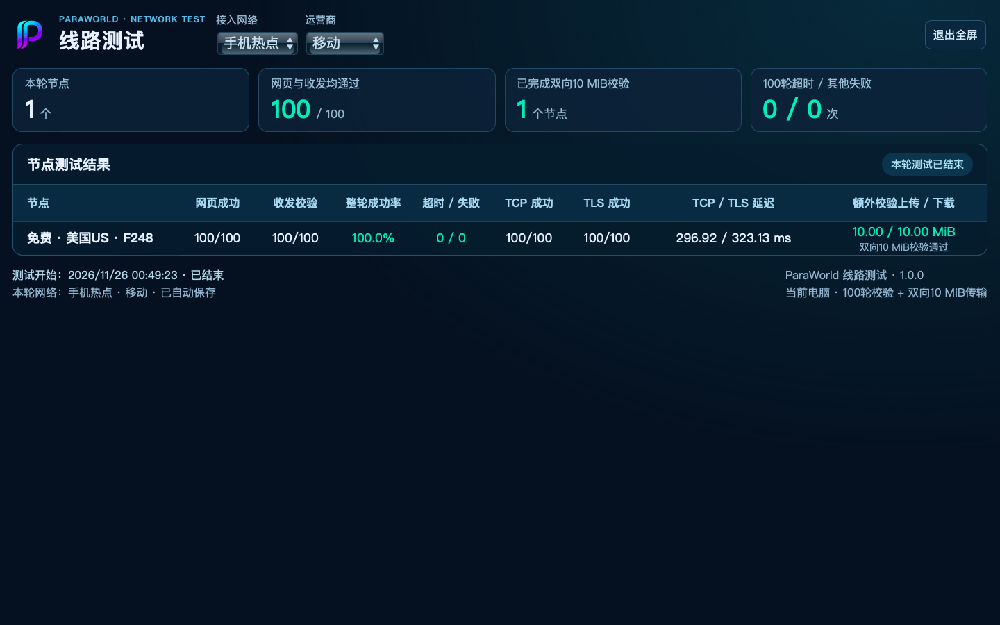

**官网：[https://paraworldlink.com](https://paraworldlink.com)**  
**电报：[https://t.me/paraworldvpn](https://t.me/paraworldvpn)**  
**YouTube：[阿飞笔记（官方客服阿飞）](https://www.youtube.com/@afeibiji)**  
**X：[https://x.com/ParaworldVPN](https://x.com/ParaworldVPN)**

# 第5期｜免费节点F248使用规则与线路测试｜2026-11-26

ParaWorld 已新增免费节点 **“免费 · 美国US · F248”**，使用 **AnyTLS 协议**。新账号的免费试用结束，或付费订阅到期后，仍可使用该免费节点，**不限制使用设备数量**。

本期分别使用电信宽带和移动手机热点测试 F248，并附上两次测试的原始截图。

## 一、节点详细信息与使用规则

| 项目 | 内容 |
|---|---|
| 节点全称 | 免费 · 美国US · F248 |
| 节点编号 | F248 |
| 所在地区 | 美国 · 洛杉矶 |
| 使用协议 | AnyTLS |
| 使用资格 | 新账号试用结束或付费订阅到期后，可继续使用免费节点 |
| 免费流量 | 每个账号每月20GB |
| 流量重置时间 | 每月15日00:00，北京时间 |
| 使用设备数量 | **不限制设备数量** |
| 每台设备带宽 | **上传与下载合计最高5Mbps** |

新账号注册后可免费试用 **3天（72小时）**，包含 **5GB试用流量**。试用期间可以使用全部节点，**不限制使用设备数量**。

试用结束后，仍可使用 **“免费 · 美国US · F248”** 节点，享有每月20GB免费流量，每台设备上传与下载合计最高5Mbps，同样不限设备数量。付费订阅到期后，也可继续使用该免费节点。

## 二、本次测试内容

本次只测试免费节点 F248，分别使用：

- **电信宽带**：2026年11月26日00:43:42开始。
- **移动手机热点**：2026年11月26日00:49:23开始。

以上均为北京时间。每种网络下连续测试100次网页访问与小数据收发，另进行上传、下载各10MiB的双向传输校验。

## 三、测试结果

| 项目 | 电信宽带 | 移动手机热点 |
|---|---|---|
| 测试节点 | 免费 · 美国US · F248 | 免费 · 美国US · F248 |
| 测试状态 | 已结束 | 已结束 |
| 网页访问成功 | 100/100 | 100/100 |
| 小数据收发校验 | 100/100 | 100/100 |
| 网页与收发均通过 | 100/100 | 100/100 |
| 整轮成功率 | 100.0% | 100.0% |
| 超时次数 | 0 | 0 |
| 其他失败次数 | 0 | 0 |
| TCP连接成功 | 100/100 | 100/100 |
| TLS连接成功 | 100/100 | 100/100 |
| TCP延迟 | 177.04ms | 296.92ms |
| TLS延迟 | 199.96ms | 323.13ms |
| 额外上传校验量 | 10.00MiB | 10.00MiB |
| 额外下载校验量 | 10.00MiB | 10.00MiB |
| 双向传输校验 | 通过 | 通过 |

两种网络下，F248 的100次网页访问与小数据收发测试均全部通过，没有出现超时或其他失败；额外上传、下载各10MiB的双向校验也均通过。

本次电信宽带的连接延迟低于移动热点。表中的延迟和传输校验量属于连接测试记录，不是下载速度测量值。

## 四、原始测试截图

**电信宽带**

**移动手机热点**

#ParaWorldVPN #平行世界VPN #免费节点 #免费VPN #不限设备数量 #AnyTLS #节点测试 #翻墙 #梯子 #科学上网 #电信宽带 #移动热点
